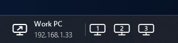

# Taskbar Widgets

Three small widgets for the Windows 11 taskbar, in the style of the Windows weather widget. Each one
is a [Windhawk](https://windhawk.net) mod, and the same code builds into a standalone app, for
running it without Windhawk. Either way the widget sits inside the taskbar itself, so it moves and
auto-hides with it: Windhawk loads the mods into Explorer, and an app puts its widget into
Explorer's taskbar from its own process.

| Widget | What it does | App |
| --- | --- | --- |
| [**Taskbar Audio Flipper**](https://windhawk.net/mods/taskbar-audio-flipper) | Switches between your speakers, headsets and microphones with a click, and turns a webcam on and off | `AudioFlipper.exe` |
| [**Taskbar RDP Launcher**](https://windhawk.net/mods/taskbar-rdp-launcher) | Starts Remote Desktop full screen on the number of displays you pick | `RDPLauncher.exe` |
| [**Taskbar Snipper**](https://windhawk.net/mods/taskbar-snipper) | Print Screen selects part of the screen to mark up and copy or save; Win+Shift+R records it as a video to trim and copy or save | `TaskbarSnipper.exe` |


Linked, they sit side by side as one: right-click any of them, open **Link widgets**, and choose
**Link with** another. Dragging any of them moves them all, and a widget that hides leaves no gap.
Linking works between the mods and the apps alike, with each one up to date: a widget on an older
version (Taskbar Audio Flipper or Taskbar RDP Launcher 1.0) doesn't follow the others.

## Taskbar Audio Flipper


- **Output** and **Input** show the device in use, with its volume. Click to switch to the next one,
  scroll to change the volume, middle-click to mute, and hover for a volume flyout like Windows'
  own.
- **Webcam** shows the chosen webcam and whether it's on. Click its camera to turn it on or off.
- **Right-click** for each section's settings: which devices take turns, a device to pick directly,
  and the links to Windows' settings.

## Taskbar RDP Launcher



- **Click 1, 2 or 3** to connect full screen on that many displays. Hover a number for a map of your
  displays, and click them to choose which ones that button uses.
- **Click the computer** (or scroll over it) for the next of your computers. Add them by name, from
  a saved .rdp file, or from Remote Desktop Connection's recent list, in the right-click menu.

## Taskbar Snipper


- **Print Screen**, or the screenshot button, freezes the screen to select an area or a window. A
  toolbox above it draws with a pencil, lines, arrows, boxes and text in any color and thickness;
  anything drawn can be dragged, restyled or deleted. Click outside the selection to copy the
  screenshot, save it, or both.
- **Win+Shift+R**, or the record button, records an area as an MP4 video. When you stop, a window
  plays it back to trim its start and end, then copies or saves it.
- **Settings**: which buttons show, the folders to save in (or choose them from the right-click
  menu), and whether Win+Shift+R is taken over from the Snipping Tool.

Each mod's full description is its readme, at the top of its file in [mods](mods).

## Getting them

### As Windhawk mods

Taskbar Audio Flipper and Taskbar RDP Launcher are in Windhawk's mod catalog: in Windhawk, search
for them under **Explore**. Taskbar Snipper isn't yet, and the files here can be newer than the
catalog's. To install one from here: in Windhawk, click **Create a new mod**, replace the example
with the file from [mods](mods), and click **Compile mod**, then **Exit editing mode**.

### As apps

Download the apps from [Releases](../../releases), or build them (below). There's nothing to
install: run one, and its widget appears on the taskbar. Its icon in the notification area has
**Settings…** (Taskbar Snipper), **Start with Windows** and **Exit**.

- An app keeps its settings in `%APPDATA%\TaskbarWidgets\<app>` and the rest in the registry, under
  `HKEY_CURRENT_USER\Software\TaskbarWidgets\<app>`. Start it with `--log` to keep a log in
  `%LOCALAPPDATA%\TaskbarWidgets\<app>`.
- Use the app or the mod: an app won't start while the same widget runs in Windhawk.
- **Coming from the old AudioFlipper or RDPLauncher app** (the C# one): exit it, then run the new
  one. It takes on the old app's settings the first time it runs, and **Start with Windows** in its
  menu takes the old app's place at startup.

## Building

The apps build with Python 3 and LLVM MinGW's Clang: Windhawk's own, found where Windhawk installs
it, or any other given with `--compiler`.

```
python tools/build.py
```

The apps come out in `build`. To build one: `python tools/build.py taskbar-snipper`.

## How it's put together

- [mods](mods): the three Windhawk mods, each one C++ file. They're the only code for each widget.
- [standalone](standalone): the host that runs a mod as an app. `windhawk_api.h` stands in for
  Windhawk's API when a mod is built into an app, and `host.cpp` provides it: settings from the
  app's settings file (with a settings window made from the mod's settings block), values in the
  registry, and a log. It starts and stops the mod as Windhawk does.
- [tools](tools): `build.py`, which also writes each app's icon, manifest and version into it, and
  the scripts that drew the icons in [icons](icons).

The widget code the three share (the taskbar window, menus, storage, and the link between them) is
in each mod, since Windhawk mods are one file each: a change there belongs in all three.

## License

MIT.
